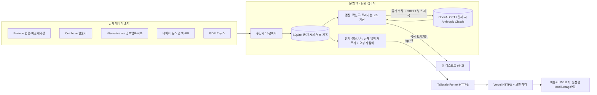

# 보안·개인정보 설계 (Top 3 Crypto · 알프레도)

기준일: 2026-10-20 · 작성: Top 3 팀(개발 김호연) · 이 문서는 "데이터가 어디서 와서 어디로 가고, 누가 무엇을 볼 수 있으며, 무엇을 남기지 않는가"를 한 장으로 설명한다.

## 1. 한눈에

| 원칙 | Top 3 Crypto에서 한 것 |
|---|---|
| 필요한 정보만 저장 | 가입·로그인·결제가 없다. 이름·이메일·전화번호를 받지 않는다. 운영 API는 접속 기록(IP)을 남기지 않게 설정했다(`--no-access-log`, 운영 반영 기록은 9절). 화면 설정은 이용자 브라우저에만 있다 |
| 공개와 비공개의 경계 | 공개 응답은 허용 목록(화이트리스트)에 적은 칸만 내보낸다. 매매 조건 세부·채점·과거 재현은 운영 맥에서 직접 연 화면에서만 보인다 |
| 남용·자동 수집 막기 | 공개 API에 접속 주소별 요청 횟수 제한(60초 600회)과 전체 제한(60초 3,000회), 알려진 AI 학습 수집기 차단(403), robots.txt·noai 표시, 이용약관의 금지 조항 |
| 외부 AI 확인 | AI에는 공개 시세 수치와 공개 뉴스 제목만 보낸다. 제공업체별 학습 사용·보관 기간·자동 이용 조항을 확인해 5절 표에 적었다 |
| 데이터 출처 약관 | 출처별 약관을 점검했고 미확인 항목은 6절에 공개한다. 네이버 검색 API 약관 개정(2026-09-07)에 맞춰 네이버 뉴스를 새 AI 입력에서 뺐다(6절) |
| 사용성과의 균형 | 로그인·쿠키 동의 창 없이 바로 쓴다. 화면 하나는 1분에 API를 몇 번만 부르므로 요청 제한은 같은 와이파이에서 여럿이 봐도 남게 잡았고, 한도에 걸려도 화면은 저장본으로 바뀐다. 검색엔진과 일반 브라우저는 막지 않는다 |

## 2. 데이터 흐름

- 이용자 → 서버 방향으로 오는 개인 데이터가 없다. 이용자 입력란이 없고, 브라우저 설정은 서버로 보내지 않는다.
- 이용자 정보가 AI로 가는 길이 없다. AI는 운영 맥의 예약 작업이 공개 자료만 넣어 부른다.
- 알프레도(향후 발전 계획 시제품)는 개발자 컴퓨터의 127.0.0.1에서만 열린다. 채팅에 적은 질문과 화면의 합성(가짜) 숫자만 GPT에 보내고, 대화는 저장하지 않는다.

## 3. 저장하는 것과 저장하지 않는 것

| 구분 | 무엇 | 어디에·얼마나 |
|---|---|---|
| 저장함 | 공개 시세(캔들·미결제약정·현물가), 공포탐욕지수 | 운영 맥 SQLite, 분석에 필요한 기간 |
| 저장함 | 뉴스 제목·링크·발행 시각(본문은 받지 않음) | 운영 맥 SQLite. 네이버 뉴스는 수신 후 21일이 지난 행을 수집 때 정리(예전 AI 분석 결과·DB 백업에 남은 제목은 8절에서 점검) |
| 저장함 | AI 분석 결과, 트리거 기록 | 운영 맥 SQLite. 공개 범위 안의 칸만 화면에 나감 |
| 저장함 | 오류 기록(접속 주소 없음) | 운영 맥 로그 파일 |
| 저장 안 함 | 이름·이메일·전화번호·계정·결제·지갑 주소·거래소 키 | 받지 않음 |
| 저장 안 함 | 접속 기록(IP·경로·시각) | 파일·DB에 남기지 않음(`--no-access-log`, 운영 반영 기록은 9절). 요청 제한용 접속 주소는 메모리에만 있고, 60초 넘게 요청이 없으면 다음 정리 때 지움(최대 5,000개, 서버를 다시 켜면 모두 사라짐) |
| 저장 안 함 | 쿠키, 광고·분석 추적 도구 | 쓰지 않음 |
| 이용자 기기에만 | 테마·색·기본 코인·알림 여부·이미 알린 트리거 목록 | 브라우저 localStorage(`top3-settings`, `top3-chart`, `top3-notified`) |

비밀값(디스코드 웹훅 주소, 뉴스 API 키)은 운영 맥의 `.env`에만 있고 저장소에는 없다(`.gitignore`). 운영 맥의 공개 주소(Funnel)도 저장소에서는 환경 변수 `TOP3_LIVE_API`로 바꿨다.

## 4. 누가 무엇을 볼 수 있나 (접근 경계)

| 보는 사람 | 볼 수 있는 것 | 어떻게 막나 |
|---|---|---|
| 누구나(공개 주소) | 확신도와 계산식, 지표 그래프, AI 분석, 뉴스, 공포탐욕, 트리거 기록(시각·코인·방향·진입가) | `top3-crypto/03_백엔드/app/public_scope.py` 허용 목록. 목록에 없는 새 칸은 자동으로 비공개. 시험 `test_public_scope.py` |
| 운영 맥에서 직접 연 사람(팀) | 위 + 매매 조건 세부, 채점, 과거 재현, 공부 7장, 검증 화면 | 요청이 맥 안에서 왔는지(프록시 머리글·Host·접속 주소)로 판정. 애매하면 공개로 본다 |
| 팀 디스코드 #신호 | 공식 트리거 알림 | 팀 서버 채널, 웹훅 주소는 `.env` |
| 바깥에서 API 문서·쓰기 | 없음 | API 문서(/docs) 기본 끔, GET만 허용, DB는 읽기 전용으로 엶 |

회원 기능이 없어 '사용자별 접근 권한'은 아직 필요하지 않다. 회원 기능을 붙이면(알프레도 상용화 단계) 6-2절 계획을 따른다.

## 5. 외부 AI: 무엇을 보내고, 어떻게 쓰이나

| 항목 | OpenAI GPT (Codex CLI) | Anthropic Claude (Claude Code, 대체용) |
|---|---|---|
| 보내는 것 | 공개 시세 수치, GDELT 뉴스 제목(네이버 뉴스는 보내지 않음). 알프레도는 이용자 질문 + 합성 숫자 | 같은 입력(GPT 실패 때만) |
| 개인정보 | 보내지 않음 | 보내지 않음 |
| 학습 사용 | 개인 플랜은 설정에 따라 학습에 쓰일 수 있음. 팀 계정은 2026-10-19 확인 때 켜져 있었고 **2026-10-20 09:38 KST에 껐다**(설정 > 데이터 관리 > '모델 개선을 위한 데이터 학습 허용'). 끈 뒤의 새 대화·Codex 작업부터 적용되며, 좋아요·싫어요 피드백을 준 대화와 Codex 'Include environments' 설정은 예외 (OpenAI 도움말 https://help.openai.com/en/articles/5722486-how-your-data-is-used-to-improve-model-performance ) | 설정 > 개인정보 > 모델 개선 토글. 팀 계정은 **꺼져 있음**(2026-10-19 확인). 피드백을 준 대화는 예외 (https://www.anthropic.com/legal/consumer-terms ) |
| 보관 기간 | 지운 대화는 30일 안에 영구 삭제 예약 (https://help.openai.com/en/articles/8983778-chat-and-file-retention-in-chatgpt ) | 학습을 끈 경우 30일 (https://privacy.claude.com/en/articles/10023548-how-long-do-you-store-my-data ) |
| 자동 이용 조항 | 개인용 약관은 '프로그래밍 방식의 출력 추출'을 금지하고, Codex 문서는 자동 작업에 API 키 사용을 권한다 (https://openai.com/policies/row-terms-of-use , https://developers.openai.com/codex/auth ) | 소비자 약관은 API 키나 명시 허용 없이 자동화된 방식의 접속을 금지한다 (consumer-terms 3조 7호) |
| 화면 표시 | 'AI 분석' 카드·탭 안에 두고, 추정치에 'AI 추정', 쓴 모델 이름을 표시 | 같음 |

**확인 결과와 계획.** 지금은 학생 프로젝트 시연 단계라 팀원 개인 구독의 공식 CLI로 하루 2번(09·21시)과 조건 충족 때만 부른다. 개인용 약관이 자동 작업을 API 키 쪽으로 안내하므로, 평가가 끝난 뒤 서비스를 계속 운영할지 정하고, 계속하면 API 키 방식으로 바꾸고 아니면 자동 호출을 멈춘다. API 방식은 제공업체가 기본으로 학습에 쓰지 않고, 조직 단위 보관 설정을 둘 수 있다. AI 결과는 화면에 나가기 전에 코드가 매번 검사한다: 권유 표현, 입력에 없는 숫자, 현재가 ±30% 밖 추정, 지시문 조각이 있으면 버린다(`top3-crypto/04_엔진/ai_analysis.py` `validate`).

## 6. 데이터 출처 약관 점검 (2026-10-19)

| 출처 | 약관 요지 | 우리가 한 것 |
|---|---|---|
| 네이버 검색 API | 2026-09-07 개정 특약: 네이버 검색결과임을 표시하고 원문 링크를 줄 것, **받은 데이터를 AI에 입력하는 행위 금지**, 서버 보관은 이력 조회 목적 최대 21일 (https://developers.naver.com/notice/article/33400 ) | 새 AI 입력(분석·심층 리포트)에서 네이버 뉴스를 뺌(`ai_analysis.py` `AI_NEWS_EXCLUDE`), 수신 후 21일이 지난 행은 수집 때 정리(`collectors.json` `retain_days`), 화면에 '네이버 뉴스 검색결과' 표시. 개정 전후로 이미 AI에 들어간 제목과 그 결과·백업은 8절에서 정리 |
| GDELT | 인용과 웹사이트 링크를 넣으면 자유 사용 (https://www.gdeltproject.org/about.html ) | 화면 하단에 GDELT 프로젝트 링크 |
| alternative.me 공포탐욕지수 | 지수 바로 옆에 출처 표시 (https://alternative.me/crypto/fear-and-greed-index/ ) | 지수 옆에 출처 링크(기존) |
| Binance 공개 시세 | 출처 표시, 제휴·후원 암시 금지 | 화면 머리에 '바이낸스 현물', 하단에 제휴 없음 문구 |
| Coinbase 현물가 | Market Data 약관(2026-08-07)은 제3자 표시·파생 지수·AI 사용을 제한한다 (https://www.coinbase.com/en-gb/legal/market_data ). 공개 REST API에도 적용되는지는 **확인 중** | 프리미엄 지수는 계속 표시하되 확인 중 항목으로 둔다. 적용된다고 확인되면 프리미엄 신호를 빼거나 서면 허락을 받는다 |

## 7. 역설계·자동 수집 막기 (여러 겹)

완전히 막는 기술은 없다. 브라우저로 보는 화면은 언제든 복사될 수 있다. 그래서 '지킬 것은 서버에만 두고, 나머지는 여러 겹으로 어렵게' 한다.

1. **서버에만 두기**: 팀이 정한 채점 기준 값·성적·프롬프트 원문·내부 메모는 공개 응답과 이 저장소에 없다(판정·채점의 계산 방식은 코드로 공개). 이 저장소의 설정은 공개용 사본이고, 채점 기준은 예시 값이다. 문턱·가중치 일부도 예시화했으므로 규칙 버전 해시는 운영과 다르다. 공개 사본으로 운영 성적을 그대로 재현할 수는 없다.
2. **요청 지킴이**: 공개 API 요청 횟수 제한(429)과 AI 학습 수집기 차단(403). `top3-crypto/03_백엔드/app/request_guard.py`, 시험 9개.
3. **요청 표시**: robots.txt와 `noai, noimageai` 표시(메타 태그·응답 헤더). 지키지 않는 수집기도 있어 보장은 아니다.
4. **약관**: 자동 대량 수집, 역공학·우회, 결과물의 AI 학습 사용을 금지(이용약관 제4조).
5. **프롬프트 주입 방어**: 뉴스 제목에 숨은 지시문은 AI 입력 전에 거른다(`04_엔진/guard.py`). 알프레도 채팅은 지시문·규칙을 꺼내 달라는 요청과 '이전 지시 무시'류를 GPT에 보내지 않고 거절하며, 답에 지시문 조각이 섞이면 바꾼다(`alfredo/mvp/chat_server.py`, 시험 8개). 알려진 패턴을 막는 것이지 완전한 방지는 아니므로, 로컬 데모 채팅에는 민감한 정보를 넣지 않는다.
6. **보안 헤더**: 남의 사이트에 끼워 넣기 금지(X-Frame-Options, frame-ancestors), 파일 형식 추측 금지(nosniff), 기기 권한 끄기(Permissions-Policy), 리퍼러 제한.

## 8. 아직 하지 않은 것 (발전 계획)

| 할 일 | 왜 아직 | 언제 |
|---|---|---|
| AI 호출을 API 키 방식으로 전환 | 학생 시연 단계, 비용 | 공개 서비스 운영 전 |
| Coinbase 약관 적용 여부 확정 | 공개 API 적용 범위 미확인 | 평가 뒤 바로 |
| 네이버 제목이 들어간 예전 AI 분석 결과·DB 백업·배포 저장본 정리 | 개정 약관 확인(2026-10-19) 뒤 새 입력부터 막았고, 지난 자료 정리는 운영 자료 삭제라 팀 확인이 필요 | 평가 뒤 바로 |
| 회원 기능을 붙일 때 사용자별 권한·저장 암호화·운영자 열람 기록 | 지금은 회원·개인정보가 없음 | 알프레도 상용화 단계 |
| 화면 전체 CSP(스크립트 출처 제한) | 화면이 깨질 위험이 있어 이번에는 frame-ancestors만 | 화면 정리 때 |

## 9. 확인 방법

- 시험: Top3 엔진 150개(1개는 비공개 참고자료가 없어 건너뜀), 백엔드 36개, 수집기 8개, 화면 3개, 알프레도 엔진 16개·데모 31개. 실행법은 [README](README.md).
- 운영 반영 기록: 이 저장소의 보안 코드(요청 지킴이, 접속 기록 끄기, 보안 헤더, 하단 링크, 네이버 AI 입력 제외)를 운영 서버·화면에 반영한 시각과 확인 방법을 아래에 적는다.
  - (운영 반영 전)
- 비밀값 검사: 이 저장소 전체를 gitleaks로 검사해 0건.
- 문의·신고: https://github.com/kimble125/top3-crypto-final/issues
