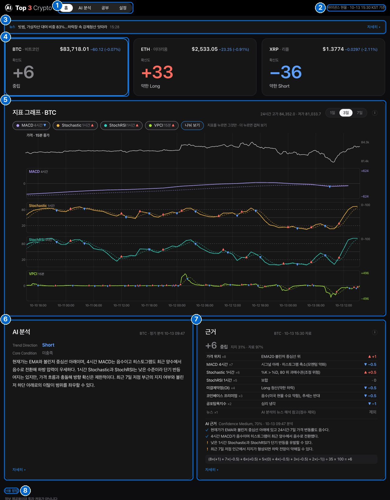
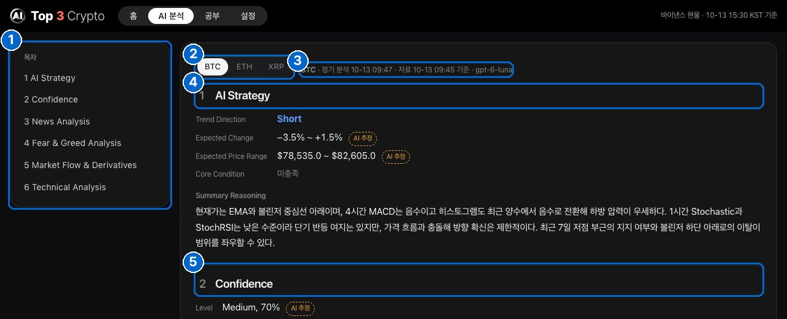
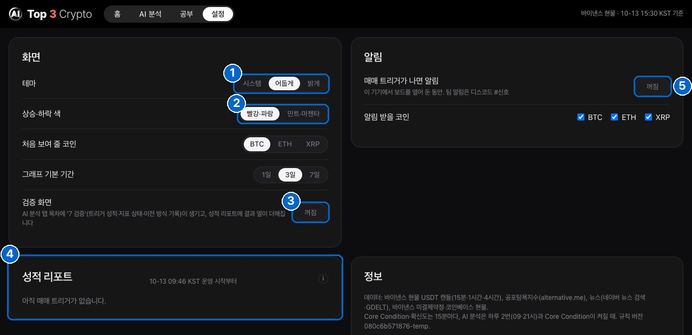

# 8장. 사용 방법

Top 3 Crypto 화면을 처음 보는 분을 위한 안내입니다. 코인이나 투자, 컴퓨터를 잘 몰라도 읽을 수 있게 썼습니다. 그림의 파란 번호와 아래 설명의 번호가 같습니다.

## 먼저 알아 둘 낱말

| 낱말 | 뜻 |
|---|---|
| 코인 | 인터넷에서 사고파는 디지털 돈입니다. 이 화면은 비트코인(BTC), 이더리움(ETH), 리플(XRP) 세 가지를 봅니다 |
| Long(롱) | 값이 오를 것 같다는 쪽입니다 |
| Short(숏) | 값이 내릴 것 같다는 쪽입니다 |
| 확신도 | 여러 신호가 같은 쪽을 가리키는 정도입니다. +는 Long, −는 Short 쪽입니다. 0에서 멀수록(+100이나 −100에 가까울수록) 신호들이 한쪽으로 모였다는 뜻이고, 맞을 확률은 아닙니다. 자료가 모자라면 숫자 대신 '자료 부족'이 나옵니다 |
| 15분봉 | 15분 동안의 가격 움직임을 한 칸으로 묶은 것입니다. 이 화면은 15분마다 새로 계산합니다 |
| 기술 지표 | 지난 가격으로 계산한 숫자입니다(MACD, Stochastic, StochRSI, VPCI). 값이 오르는 힘이 센지 약한지를 봅니다 |
| 미결제약정(OI) | 아직 정리되지 않은 선물 계약의 양입니다. 값이 오르면서 늘면 새 돈이 들어온다는 뜻입니다 |
| 코인베이스 프리미엄 | 미국 거래소(코인베이스)의 가격이 다른 거래소보다 비싼 정도입니다. +면 미국에서 사려는 사람이 많다는 뜻입니다 |
| Core Condition | 기술 지표 여러 개가 정해진 순서대로 같은 쪽을 가리키는지 보는 조건입니다 |
| 매매 트리거 | Core Condition과 AI 분석이 같은 쪽을 가리킬 때 나는 알림입니다 |

## 홈 화면

1. **탭**: 홈 · AI 분석 · 공부 · 설정 중 하나를 누르면 그 화면으로 갑니다. 문제가 생기면 '⚠ 상태' 탭이 새로 나타납니다(아래 "문제가 생기면").
2. **기준 시각**: 확신도·가격·Core Condition을 계산한 자료의 시각입니다. 15분마다 바뀝니다. AI 분석은 따로 시각이 붙어 있습니다(AI 분석 카드 오른쪽 위).
3. **뉴스 띠**: 최근 코인 뉴스 제목이 10초마다 바뀝니다. 마우스를 올리면 멈추고 최근 목록이 펼쳐집니다. 목록의 제목을 누르면 기사가 열립니다. 오른쪽 '자세히 ▾'는 AI가 정리한 뉴스 해설로 갑니다.
4. **확신도 카드**: 세 코인의 지금 가격과 확신도입니다. 빨간 +는 오를 쪽, 파란 −는 내릴 쪽으로 신호가 모였다는 뜻입니다(설정에서 색을 바꿀 수 있습니다). 카드를 누르면 아래 그래프·AI 분석·근거가 그 코인으로 바뀝니다.
5. **지표 그래프**: 가격과 지표 네 개의 최근 흐름입니다. 오른쪽 위 버튼으로 1일·3일·7일을 고릅니다. 지표 버튼을 누르면 그 지표만 크게 보입니다. 그래프 위에 마우스를 올리면 그때의 값이 나옵니다.
6. **AI 분석**: AI가 쓴 짧은 시장 해설입니다. Trend Direction은 AI가 본 방향, Core Condition은 매매 트리거 조건이 지금 맞았는지입니다. '자세히 ▾'를 누르면 전체 분석으로 갑니다.
7. **근거**: 확신도가 어떻게 나왔는지입니다. 신호 여덟 개가 위에서부터 중요한 순서로 있고, 오른쪽의 ▲(오를 쪽)·▼(내릴 쪽) 숫자에 무게(×8 등)를 곱해 더합니다. 아래 'AI 근거'는 AI가 꼽은 근거(✓)와 위험(!)입니다. '자세히 ▾'를 누르면 계산 표 전체로 갑니다.
8. **사용 방법**: 이 장으로 오는 길입니다.

## AI 분석 화면

1. **목차**: 누르면 그 부분으로 바로 갑니다. 지금 읽는 부분이 진하게 표시됩니다.
2. **코인 버튼**: BTC·ETH·XRP 중 하나를 고릅니다.
3. **시각**: 분석을 만든 때(정기 분석은 매일 9시·21시)와 AI가 읽은 자료의 시각입니다.
4. **1 AI Strategy**: AI가 본 방향(Trend Direction), 예상 변동률과 가격 범위, Core Condition, 요약입니다.
5. **2 Confidence**: AI가 매긴 확신(Level)과 근거·위험, 그리고 홈 확신도를 계산한 표 전체입니다.

그 아래로 3 뉴스, 4 공포탐욕지수(시장 분위기 점수 0–100), 5 시장 흐름(미결제약정·코인베이스 프리미엄), 6 기술 지표가 이어집니다. 'AI 추정'이라고 붙은 숫자는 AI가 내놓은 예상이라 틀릴 수 있습니다.

## 설정 화면

1. **테마**: 어둡게·밝게 중에서 고릅니다. '시스템'은 컴퓨터 설정을 따릅니다.
2. **상승·하락 색**: 오를 쪽·내릴 쪽 색을 빨강·파랑 또는 민트·마젠타로 바꿉니다. 맨 위 'Top 3'의 3도 같은 색으로 바뀝니다.
3. **검증 화면**: 만드는 사람이 확인하는 자세한 기록을 켭니다. 팀이 쓰는 컴퓨터(팀 Mac)에서 직접 연 화면에만 있고, 공개 화면에는 나오지 않습니다.
4. **성적 리포트**: 지금까지 난 매매 트리거 기록(시각·코인·방향·그때 가격)입니다.
5. **알림**: 이 컴퓨터에서 화면을 열어 둔 동안 매매 트리거가 나면 알려 줍니다. 처음 켤 때 브라우저가 허락을 묻습니다.

## 문제가 생기면

- 맨 위에 '⚠ 상태' 탭이 보이면 자료가 늦거나, 저장해 둔 화면을 보고 있다는 뜻입니다. 눌러 보면 무엇이 문제인지 나옵니다.
- '기준 시각'은 보통 15분마다 바뀝니다. 35분이 넘게 그대로면 자료가 멈춘 것이고, 이때도 '⚠ 상태' 탭이 나타납니다.

## 꼭 기억할 것

- 이 화면은 정보를 보여 줄 뿐, 사고팔라는 권유가 아닙니다.
- 확신도와 AI 분석은 지난 자료로 계산한 것이라 앞으로를 보장하지 않습니다.
